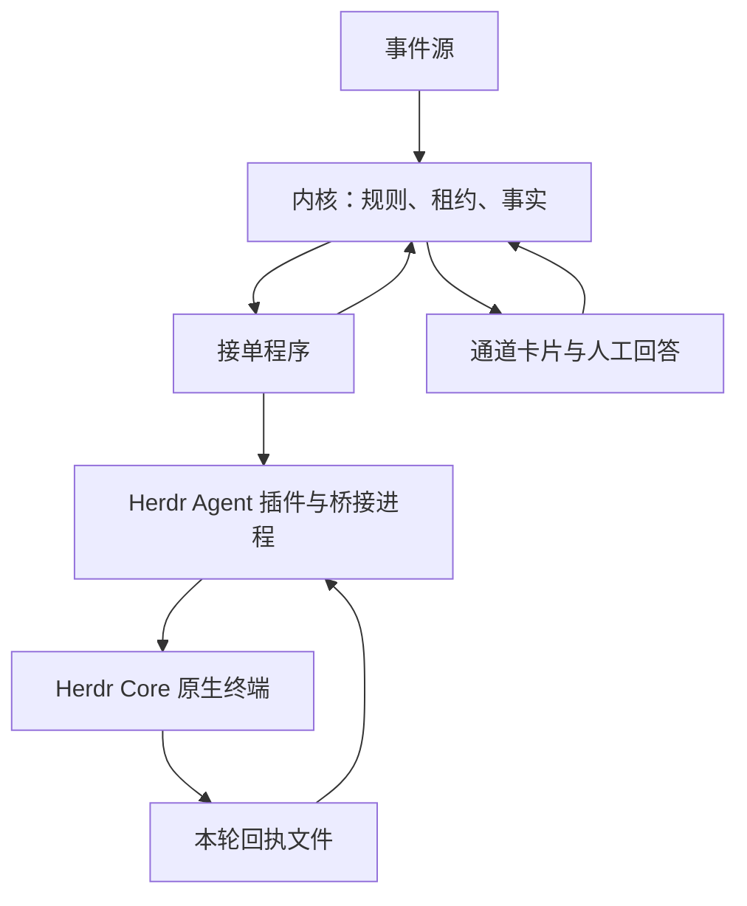

# Herdr Core 接入、迁移与验收

本版本保留原有 `kernel / host / protocol / worker / plugins` 分层，把内置 AI 执行入口统一为 `plugins/herdr-core`。事件、规则、并发、租约、卡片、失败重试和事实日志仍属于中台。Herdr Core 管理原生终端；本插件管理中台执行与终端的对应关系、明确提交的回执，以及失联后的核实。

这是一次配置不兼容的替换。旧的 AI 执行插件和安装参数不再提供。固定采集脚本使用 `script` 插件；交付流水线仍使用 `delivery`，其中的 AI 审查调用同一个 Herdr 任务接口。没有新增调度服务、Web 面板或运行时 npm 依赖。

实现入口是 [Agent 适配器](../plugins/herdr-core/agent.ts)、[任务执行](../plugins/herdr-core/task.ts)、[回执提交器](../plugins/herdr-core/receipt.ts)、[持久化记录](../plugins/herdr-core/store.ts)和[接单程序](../worker/worker.ts)。HTTP 业务协议仍见 [protocol.md](protocol.md)。

## 1. 职责和执行路径



| 层 | 保留或承担的职责 | 不应下沉或新增的职责 |
|---|---|---|
| `kernel` | 事件匹配、事项、轮次、租约、卡片、重试、事实追加 | 不认识 Herdr、终端或模型品牌 |
| `host / protocol` | HTTP、授权、插件加载、协议校验 | 不直接启动或观察原生 AI |
| `worker` | 领取、心跳、桥接进程、停止、结果提交与恢复 | 不解释每一种原生 CLI 的参数和画面 |
| `herdr-core` 插件 | profile 校验、终端绑定、本轮回执、执行核实 | 不另建队列、定时器调度或业务状态机 |
| Herdr Core 和本机 template | 原生终端、输入、状态报告、原生工具配置 | 不决定中台规则或替中台回答业务卡片 |
| `delivery / script` | 确定性的交付步骤或固定程序 | 不保留另一套 AI 启动参数适配 |

`command(turn)` 启动一个短桥接入口，`read(stdout, code, stderr)` 仍读取统一结果。桥接进程可以退出，原生终端仍然存在；因此桥接退出码不能单独证明业务失败或取消。持久插件另外实现 `recover` 和 `stop`，接单程序通过这两个接口核实真正的执行。

插件直接使用 `hc connect --session <分组名>` 提供的 OpenRPC 连接，调用 `terminal.run`、`terminal.send`、`terminal.get` 和事件订阅。不会把交互屏幕、历史尾部或看到某个代码块当成可靠的最终答案。命令与事件订阅使用各自的连接，订阅断开后仍需重新读取当前终端状态。

## 2. 安装与 profiles

先安装 Node.js 24、Git、curl、Herdr Core，以及要使用的原生 Agent；完成原生 Agent 自己的登录。Herdr 安装入口：

```bash
curl -fsSL https://releases.herdr.dev/core/install.sh | sh
hc --version
hc templates
```

本机 template 放在 Herdr 的 `~/.config/herdr-core/templates/` 中。template 负责选择原生程序、模型、工具、权限及其状态报告方式；Autoloop 不生成某个品牌的命令参数。请先用 Herdr 原生方式验证该 template 能完成一轮、报告 `done` 并接受下一轮。仅能在终端显示文字但没有可验证状态的程序，不能自动完成中台任务。

把可信配置写入 `~/.agent-autoloop/herdr/profiles.json`。设置 `AGENT_AUTOLOOP_HOME` 时，以那个目录为准：

```json
{
  "profiles": {
    "developer": {
      "template": "aal-developer",
      "access": "edit",
      "session": "autoloop"
    },
    "review": {
      "template": "aal-review",
      "access": "read",
      "session": "autoloop"
    },
    "browser": {
      "template": "aal-browser",
      "access": "read",
      "session": "autoloop"
    }
  }
}
```

这些 template 名称是示例，必须替换成 `hc templates` 实际列出的名称。profile 是本机管理者的配置，事件、PR 正文和网页内容不能选择或修改它。

| profile 字段 | 含义 |
|---|---|
| `template` | 必填，本机已有 Herdr template 名称 |
| `access` | 必填，`read / edit / full`；必须与可信规则中的值完全一致 |
| `hc` | 可选，可执行文件参数数组，默认 `["hc"]`；不经过 shell |
| `session` | 可选，Herdr Core 分组名，默认 `autoloop`；不是业务 session |
| `cwd` | 可选，绑定一个现有目录；比较规范化真实路径 |
| `rpcTimeoutMs` | 可选，单次 RPC 等待上限，默认 15000 毫秒 |
| `turnTimeoutMs` | 可选，观察一轮的上限，默认 10800000 毫秒；超时不能证明任务失败或停止 |
| `monitorIntervalMs` | 可选，核实状态间隔，默认 1000 毫秒 |

`access` 一致性校验只是配置约束。它不替原生程序创建系统沙箱；把字符串设成 `read` 并不能阻止一个权限过大的 template 写文件。特别是只读 profile 仍需要允许读取本轮资料、写一份回执文件及调用指定的本地回执提交器。这是精确的回执通路例外，不能变成执行 PR 命令或任意 shell 的权限。

安装这个分支并初始化：

```bash
curl -fsSL https://raw.githubusercontent.com/NAMEWTA/agent-autoloop/main/install.sh | sh -s -- --profile developer
agent-autoloop check
agent-autoloop doctor
agent-autoloop up
```

默认安装会启用常驻服务；已经运行服务时无需再启动第二个 `up`。在没有服务管理器的环境中加 `--no-service`，保留前台 `up` 进程。`doctor` 检查 profile 和可执行文件；真正的 Herdr 握手、template 存在性、状态报告及回执写入还要通过一次实际任务验证。

已有规则中的 Agent 这样登记：

```json
{
  "agents": {
    "developer": {
      "name": "开发 Agent",
      "worker": "my-computer",
      "use": "herdr-core",
      "access": "edit",
      "options": { "profile": "developer" }
    }
  },
  "rules": [
    {
      "name": "开发任务",
      "when": { "source": "github", "types": ["issues.opened"] },
      "to": "developer",
      "cwd": "/absolute/path/to/worktree",
      "skill": "handle-issue",
      "parallel": 1
    }
  ]
}
```

`cwd` 是规则字段；原生程序、模型及权限参数放在 template。不要在 Herdr Agent 配置中再加 `command`。固定采集程序用 `use: "script"` 和可信的 `command` 参数数组；只支持 `{cwd}`、`{context}` 这类资料位置替换，不支持模型提示词或会话占位符。

## 3. 执行身份与终端身份

| 身份 | 来源和用途 | 何时改变 |
|---|---|---|
| 业务 run | 中台轮次编号，拥有独立的 HTTP token | 中台新派一轮时 |
| attempt | 中台这轮执行的尝试编号 | 中台按既有失败规则重派时 |
| execution.turn | 接单程序在一次尝试中的调用序号，包括回执修复 | 接单程序明确发起下一次调用时 |
| Autoloop session | 逻辑会话，保存原生上下文绑定 | 新的逻辑会话；不能用新终端冒充旧会话 |
| Herdr terminal | Core 身份、终端地址、创建时间、标签、真实目录和 profile 指纹 | Herdr 实际创建终端时 |

任务 ID 由逻辑 session 和 `run / attempt / turn` 稳定计算。同一执行编号带着不同的 prompt、资料、目录或 profile 再来，会被拒绝。逻辑 session 不直接当作终端地址使用；Herdr 的 `profile.session` 也只是 Core 分组，不是这两个标识中的任意一个。

新会话创建前先持久化任务与投递意图。首次消息必须由 Herdr 确认送入；续接先核对原终端身份和空闲状态，再发送，始终不强制绕过原生审批。终端丢失、Core 重建、目录或 profile 改变时，不会自动启动一个新终端并称为续接。`keep` 关闭，避免底层进程退出后用新 shell 冒充仍存活的原生 Agent。

同一个 session 和同一个真实目录都受到持久占用约束。桥接进程死亡会释放其进程租约，但不会因此证明原生任务结束；未核实的任务仍占用对应的 session 和目录。需要真正并行改同一仓库时，配置不同 Git worktree。不能靠提高 `parallel` 让两个写入者共用一个目录。

## 4. 回执：明确提交，再确认本轮结束

接单程序仍要求最后回复遵守原有业务格式：第一行结局，后面可附 `agent-autoloop` JSON 代码块，包含 `ask / notice / later / events` 等。改变的是它的传输方式。

每次原生调用都有独立的资料副本、请求文件和随机 nonce。提示词给出本次回执提交器的完整 argv。Agent 生成一个 JSON 文件：

```json
{
  "text": "待你处理：需要选择一个方案。\n\n```agent-autoloop\n{\"ask\":[{\"key\":\"decision\",\"title\":\"选哪一个？\",\"options\":[\"方案 A\",\"方案 B\"]}]}\n```"
}
```

然后执行本轮提示词提供的提交器。不要复制上一轮的请求路径、nonce 或提交命令。提交器验证任务身份，把完整结果原子写入预定位置：相同结果重复提交可以接受，不同结果不能覆盖已经提交的结果。用量只填写实际获得的计量；没有真实计量就省略，不能把未知写成零。

插件只有同时读到匹配当前执行的有效回执，以及原生状态报告的本轮 `done`，才返回 `finished: true`。原生轮次必须推进，旧的 `done`、屏幕回显、历史里的代码块、工具输出和空闲一段时间都不能代替这两个条件。回执文件不包含中台 token，原生 Agent 也不直接调用中台。

这条通路主要防止串轮、半写、重复覆盖和误读屏幕。它不是同一系统账号内的对抗性隔离：拥有任意本机文件权限的程序仍能影响本地文件，真实权限依赖 template、系统账号或容器边界。

业务回执格式错误时，接单程序可接着原会话发起最多两轮修复。修复是新的 `execution.turn`，有新的请求和回执位置。修复指令禁止重复业务操作，但允许读取本轮资料并使用指定回执提交器；不能同时要求“任何工具都不要调用”而又依赖提交器完成。修复失败保留原业务结局，不把已做完的业务转为自动重试。

## 5. 等人、阻塞和结果不明

| 情况 | 中台和插件行为 | 操作者下一步 |
|---|---|---|
| 有效最终回执含 `ask` | 当前轮结束，中台发业务卡片；终端可继续驻留 | 回答卡片后，后续轮使用原逻辑 session |
| 原生 CLI 等待工具审批、登录或呈现 `blocked` | 不能推断业务 `ask`，执行保持不确定 | `inspect` 查看，使用原生终端处理授权或核实停止 |
| `terminal.send` 的响应丢失 | 已投递与未投递无法区分；不自动重发 | 核实原终端，等待可信结果或明确停止 |
| RPC 断开、状态缺失、终端不见 | `state: "uncertain"`，保留执行证据和占用 | 连接恢复后只读核实，不新建会话 |
| bridge 退出、worker 重启 | 从原持久记录恢复观察 | 原执行结果仍可提交，不重做已发出的工作 |
| 超时 | 先确认真正的原生执行是否停止 | 未确认停止就不能报告可重试失败 |
| 本人要求停止 | 插件核对目标并请求停止，确认终端结束后接单程序才报告取消 | 查询状态确认，不能以桥接进程已退出代替 |

**业务等待不会自动再调用模型，但不是零进程、零内存。** Herdr、原生终端及其工具可以仍然驻留。正常情况下业务轮结束后 bridge 退出；运行时失联后的核实可能仍需要接单程序周期性检查。也不能保证一个自行启动后台工具的原生 Agent 绝不会继续产生外部调用。

`unknown` 是现有内核在租约到期后作出的状态，不是插件可以上传的新 `outcome`。HTTP 结果仍只接受 `done / nothing / failed / cancelled`。接单程序保留在线心跳，仅把有可验证执行证据的任务列入 `running`；无法证明仍正常执行的任务从该列表移除，原有租约到期后内核标记结果不明。后续核实到结果时仍用原轮次身份提交。

内核的 `unknown` 不占规则 lane，但它不表示原生进程已退出。插件保留 session 和目录占用，以免新任务和未知的旧任务同时写入。恢复只观察旧请求，不自动重发、不自动换终端，也不把未知当成 `failed` 触发新一轮。外部操作与本地日志无法做一个事务，因此本实现不承诺外部副作用恰好执行一次。

## 6. 查看、接管与停止

```bash
agent-autoloop status
agent-autoloop why 42
agent-autoloop plugin herdr-core list
agent-autoloop plugin herdr-core inspect <逻辑session>
agent-autoloop plugin herdr-core pause <逻辑session>
agent-autoloop plugin herdr-core resume <逻辑session>
agent-autoloop plugin herdr-core stop <逻辑session>
```

`inspect` 返回终端绑定和 `attach` 的 argv、环境变量。按返回值操作；特别是 attach 使用对应的 `HC_SESSION` 环境，不能臆造 `hc attach --session` 参数。不要把终端地址当作恢复身份或修改持久记录来解除占用。

`pause` 阻止之后的新输入，不暂停正在执行的原生进程。`resume` 允许之后的新输入，不重放尚未确认的投递。`stop` 请求并核实实际终端停止；活动任务还要由接单程序完成中台取消结算。对已完成、闲置的终端做停止是资源清理，已经接受的回执仍保留。控制台命令由插件接口提供，中台 CLI 不含 Herdr 产品分支。

手工进入终端期间，先明确谁负责输入。人手工发送一条新任务与 bridge 同时发送会破坏轮次关联；不要用手工输入“继续”来替代尚未确认的业务投递。完成核实后通过原会话继续或明确停止。

## 7. 交付与浏览器的特别边界

### 交付审查

`ops/delivery.json` 的审查设置来自 main：

```json
{
  "review": {
    "points": "AGENTS.md",
    "profile": "review",
    "xhigh": ["auth/**"],
    "xhighProfile": "review-deep",
    "status": "agent-review"
  }
}
```

`review-deep` 也要在本机配置为 `access: "read"`。不需要升级档位时省略 `xhigh` 和 `xhighProfile`；非空 `xhigh` 必须有对应 profile。模型和推理档位放在不同 template 内，不向原生 CLI 注入品牌参数。

交付插件仍从裸 Git 对象生成文字快照，审查 cwd 只有 `changes.txt`，审查要求读取 main。不得 checkout PR，或运行 PR 的代码、测试、配置、hooks。profile 管理者必须实测原生工具的只读边界，关闭会自动加载 PR 或个人配置的入口，并仅为指定回执通路留写入例外。插件不能代替不可信 template 提供沙箱。

审查子任务用仓库、main/head、profile、要求和 diff 形成稳定身份，保存快照和调用记录。顶层交付进程退出、重试或中台重启后使用同一份子任务记录；不会每次生成新 session。只有明确确认旧原生审查停止后，才允许新的审查代次。审查结果不明时，外层交付不能自动重派新的 AI 审查。

这次替换保留所有原有放行条件：main 设置、分支自己的 diff、合并冲突解法、同一提交的完整检查、草稿不得放行、head/main 再校验、关闭自动合并、丢失合并响应读回，以及 Ship 和健康版本共同核实。不能以“AI 说通过”代替这些边界。

### 浏览器委托

[浏览器交接模板](../examples/recipes/browser-handoff/README.md)也调用同一个 `runTask / recoverTask`。主任务与网页助手分别使用逻辑 session 和 cwd，防止父任务持有目录占用、子任务又等待同一目录而相互阻塞。

网页助手使用每个 session 的独立工作目录；目标网址、允许操作、profile 来自可信 `browser.json`。结果不明时，`--resume` 只核实原调用，不再次发送网页操作。主任务仍负责业务决定和回执；浏览器权限、本人登录和可访问的既有浏览器由原生环境提供。

## 8. 从旧配置迁移

1. 停止接入新任务，查看 `status` 和 `why`，核实正在执行及结果不明的轮次。先处理这些原生执行，不能仅删除状态文件后重跑。
2. 安装并验证 Herdr template 和 profiles。确定各自权限、工作目录和回执文件例外，实测两轮原生会话。
3. 将 AI Agent 配置改成 `use: "herdr-core"`、明确 `access` 和 `options.profile`。模型、推理参数及原生命令迁入 template。已有活跃原生会话不会自动转换为 Herdr session。
4. 确定性轮询、HTTP 拉取等固定程序改成 `use: "script"`。移除模型提示词和会话占位符；不借固定脚本保留被移除的 AI 适配入口。
5. main 中交付设置改为 `review.profile`；删除命令替换字段，配置只读审查 profile。
6. 安装命令使用 `--profile <name>`，或为纯固定脚本使用 `--script /absolute/path/to/executable`。旧 AI 选择和自由命令字符串入口不兼容，校验失败时修配置，不自动降级。
7. 运行 `check`、`doctor`、实际问答和恢复验收，再恢复事件输入。已有事实日志、规则审计和业务卡片仍由中台持久化；更换执行插件不要求篡改旧事实。

不要把原生凭据复制到 profile，也不要把中台凭据交给 template。长期保留的资料、终端历史、回执和审查快照可能包含业务信息，按本机私有数据管理。清理只对已核实停止的目标进行；本版本没有自动清理未知终端的定时任务。

## 9. 验收矩阵

| 场景 | 必须观察到的结果 | 验证方式 |
|---|---|---|
| profile 不存在、权限不匹配、目录不匹配 | 投递前拒绝，不启动另一种执行方式 | 配置与插件测试 |
| 首次执行及第二轮回答 | 真实 native turn 推进；两份独立回执；同一逻辑 session | 假 RPC、真实 HTTP 中台循环测试及本机 `try` |
| 旧屏幕、旧 nonce、重复不同回执 | 不被接受为当前结果，不覆盖首次结果 | 回执和恢复测试 |
| 发消息响应丢失 | 无第二次发送；保留原终端身份 | 假 RPC 故障测试 |
| bridge / worker 崩溃 | 观察同一执行，不启动新的 AI | 持久 worker 与插件恢复测试 |
| CLI blocked、无状态、终端消失 | 不确定，继续在线；租约到期进入 unknown | 插件与 worker 测试 |
| 取消、超时、停止确认失败 | 不虚报 stopped，不开始冲突写入者 | 停止和占用测试 |
| 同 cwd 并发 / 父子 browser | 前者受占用约束；后者使用不同目录 | 目录占用与浏览器测试 |
| delivery 重试 / PR 恶意配置 | 稳定子任务身份；main-only 配置与文字快照 | 原交付边界测试和新增 review 测试 |
| 原生只读和回执通路 | 业务目录不能写；指定回执能写；两轮成功 | 操作者对实际 template 做权限验收 |

仓库测试使用临时 home、假 Herdr RPC 和假外部服务；它们不能证明某台电脑的 template、模型登录、原生权限或 OSC 状态已接通。本机真实执行用 `node scripts/real-agents.ts <profile>`；MCP 协议检查用 `node scripts/real-protocols.ts mcp`，不依赖 AI。真实交付脚本会创建、修改并删除测试仓库，只有明确要求时才运行。

完整检查仍是 `npm test`、`npm run typecheck` 和 `npm run format:check`；结果以实际执行记录及 CI 为准，不把未运行的原生 smoke 或权限检查写成通过。
